<div align="center">



[](https://github.com/Hafsa-Khan01)
[](https://github.com/Hafsa-Khan01)
[](https://github.com/Hafsa-Khan01)

</div>

```bash
┌──(hafsa㉿noirbyte)-[~]
└─$ whoami
hafsa-khan

└─$ cat identity.log
NAME       : HAFSA KHAN
ROLE       : CYBERSECURITY STUDENT & SECURITY BUILDER
INTERESTS  : RESEARCH / DIGITAL DEFENSE / SECURE SYSTEMS
MINDSET    : LEARN -> INVESTIGATE -> BUILD -> IMPROVE
```

> **Curiosity creates. Knowledge protects.**

<div align="center">

</div>


<div align="center">

</div>

### `01 // CURRENT.MISSION`

```console
[MISSION LOADED]

[+] Strengthening cybersecurity, networking and Linux foundations
[+] Exploring service fingerprinting and security monitoring
[+] Building tools for authorized security assessment
[+] Practicing investigation, documentation and evidence handling
[+] Learning how AI systems can be governed and secured

STATUS : IN PROGRESS
```


<div align="center">

</div>

### `02 // TOOLKIT`

<div align="center">


</div>

```bash
└─$ ls ./working-toolkit
python/  linux/  powershell/  fastapi/  sqlite/
wireshark/  nmap/  git/  github/

└─$ ls ./security-specialities
vapt-wapt/  soc-operations/  network-security/
threat-intelligence/  digital-forensics/  incident-response/
purple-teaming/  security-research/  service-fingerprinting/
ai-security/

NOTE: Tools, domains and practical areas I am actively learning,
      exploring and applying in authorized projects.
      This is a developing skill set, not a claim of mastery.
```


<div align="center">

</div>

### `03 // SELECTED.WORK`

```bash
┌──(hafsa㉿noirbyte)-[~/projects]
└─$ ./project-index --show

[PUBLIC]
CyberForge Labs  ->  OPEN ACCESS

[RESTRICTED // PRIVATE REPOSITORIES]

NexCYR
[CLASSIFIED BUILD] // [ACCESS: RESTRICTED] // [STATUS: IN DEVELOPMENT]

AiHirSaq
[SHADOW PROTOCOL] // [ACCESS: RESTRICTED] // [STATUS: ACTIVE DEVELOPMENT]

SCATTER AI
[BLACK-OPS MODE: OFFLINE] // [ACCESS: RESTRICTED] // [STATUS: UNDER CONSTRUCTION]

[SECURITY NOTICE] Source code and project details are intentionally undisclosed.
```

#### `PUBLIC // CYBERFORGE LABS`

<div align="center">

[](https://github.com/Hafsa-Khan01/CyberForge-Labs)

<sub>OPEN SOURCE // PUBLIC ACCESS</sub>

</div>


<div align="center">

</div>

### `04 // RESEARCH.DIRECTION`

```console
$ cat research-queue.txt

[01] Network & service fingerprinting
[02] SSH, PostgreSQL & web-server identification
[03] Security monitoring & incident investigation
[04] Vulnerability assessment methodology
[05] AI-agent security & event integrity

$ echo "Evidence first. Assumptions last."
Evidence first. Assumptions last.
```


<div align="center">

</div>

### `05 // CONNECT`

<div align="center">

```bash
┌──(hafsa㉿noirbyte)-[~]
└─$ git clone curiosity://knowledge/security
Cloning into better-understanding...
done.
```

[](https://github.com/Hafsa-Khan01?tab=repositories)

<sub>Building knowledge, one investigation at a time.</sub>

</div>
